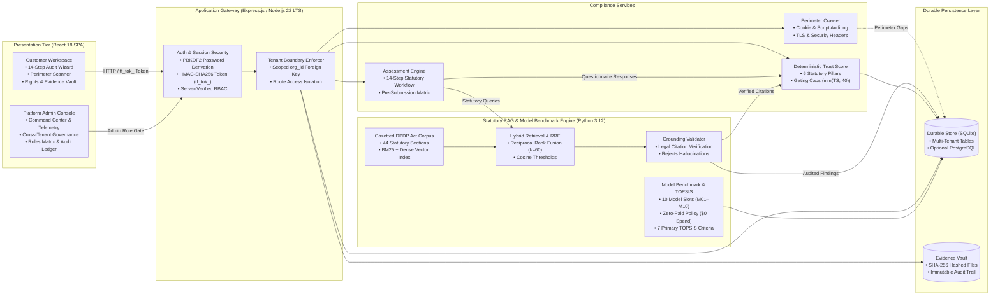

# TrustForge™ - Autonomous DPDP Compliance & Privacy Assurance Platform

[](https://github.com/Mannan55/TrustForge/actions/workflows/ci.yml)
[](https://github.com/Mannan55/TrustForge/releases/tag/v1.0.0-release)
[](LICENSE)
[](https://www.meity.gov.in)

**TrustForge** is an automated compliance auditing, risk assessment, and decision-support platform engineered to benchmark enterprise data privacy practices against India's **Digital Personal Data Protection (DPDP) Act 2023** (Act No. 22 of 2023).

The platform bridges the gap between statutory legal mandates and technical engineering implementations, delivering objective Trust Scores, automated perimeter vulnerability scans, structured evidence management, and multi-model benchmark evaluation.

---

## Key Capabilities

### 🏢 Customer Compliance Suite
* **Non-Invasive Domain Scanner:** Evaluates internet-facing web properties for affirmative cookie banners, third-party tracking scripts, SSL/TLS transport configurations, and statutory privacy notice links.
* **14-Step Statutory Assessment Wizard:** Comprehensive questionnaire auditing organizational controls across all chapters of the DPDP Act 2023 (Notice, Consent, Purpose Limitation, Retention, Accuracy, Security, Breach Management, Minor Safeguards, and Data Principal Rights).
* **Deterministic Trust Score Engine:** Computes a normalized compliance posture score in $[0, 100]$ across six canonical statutory pillars, featuring critical failure gating caps (capping scores at $\le 40$ if HTTPS or privacy notices are missing).
* **Vulnerability Findings Vault:** Prioritizes compliance defects, maps each issue to its governing legal citation and statutory penalty exposure, and generates actionable remediation guidance.
* **Cryptographic Evidence Locker:** Ingests organizational policies and architectural proofs with SHA-256 cryptographic hashing to maintain an auditable chain of custody.
* **Data Principal Rights Portal:** Streamlines citizen privacy requests (Access, Correction, Erasure, Nomination) with statutory 30-day SLA resolution countdowns.

### 🛡️ Administrative Governance Console
* **Isolated Role Gate:** Strictly partitions administrative governance from tenant accounts, verifying the `platform_admin` role directly on the backend.
* **Platform Command Center:** Global operational dashboard aggregating cross-tenant compliance metrics, scan queues, and active worker telemetry.
* **Multi-Tenant Organization Management:** Superadmin controls for tenant directory inspection, domain verification token overrides, and Significant Data Fiduciary (SDF) tier assignments.
* **Statutory Rules Matrix:** Allows authorized legal engineers to configure scoring weights, penalty multipliers, and section thresholds dynamically.
* **Forensic Security Audit Ledger:** Append-only audit log capturing actor IP, timestamp, action performed, and HTTP status codes for every administrative touchpoint.

---

## System Architecture

TrustForge implements a layered, local-first architecture engineered for high auditability, multi-tenant security, and zero recurring API costs. The platform decouples user interactions, statutory retrieval, model evaluation, and compliance scoring into distinct functional tiers:



### Architectural Subsystems & Separation of Concerns

* **Presentation Tier:** Delivers distinct workflows for enterprise compliance assessors and platform administrators. Client sessions communicate via custom HMAC-SHA256 tokens (`tf_tok_...`), while the Admin Console is guarded by server-verified `platform_admin` role checks.
* **Application Gateway & Security Layer:** Enforces PBKDF2 password derivation (SHA-512, 10,000 iterations), constant-time token verification, and mandatory `org_id` tenant scoping across all route handlers.
* **Compliance & Assessment Services:** Coordinates active non-invasive perimeter crawlers, the structured 14-step statutory assessment questionnaire, and evidence ingestion.
* **Statutory Retrieval & Grounding Gate:** Decouples legal knowledge from model evaluation. Legal sections from the DPDP Act 2023 corpus are retrieved using hybrid BM25 and dense vector search fused via Reciprocal Rank Fusion ($k=60$). The **Grounding Validator** strictly inspects all model-generated compliance statements, discarding ungrounded citations before findings can influence scores.
* **Deterministic Trust Score Engine:** Computes a normalized score in $[0, 100]$ across six statutory pillars (Privacy, Security, Transparency, Governance, Lifecycle, Rights) with mandatory gating caps (e.g., missing HTTPS or privacy notices automatically cap scores at $\le 40$).
* **Model Benchmarking & TOPSIS:** Standardizes evaluation across 10 designated model slots (M01–M10) using 7 primary TOPSIS decision criteria. Commercial models (M06–M09) are strictly gated to preserve the zero-paid commercial inference boundary ($0.00 spend).
* **Durable Multi-Tenant Storage:** Combines a local-first SQLite engine with tenant-isolated directories, SHA-256 file hashing, and an append-only security audit ledger.

> 🔍 **Deep-Dive Architecture & Sequence Pipelines:**  
> For component-level data flow diagrams, sequence specifications, and failure-mode handling, consult the [Detailed Technical Architecture Specification](docs/architecture/DETAILED_ARCHITECTURE.md).

---

## Technology Stack

| Layer | Technologies |
| :--- | :--- |
| **Frontend** | React 18, TypeScript 5, Vite, Tailwind CSS, Lucide Icons, Playwright |
| **API Gateway** | Node.js 22 LTS, Express.js 4, TypeScript, Native Crypto (PBKDF2, HMAC-SHA256) |
| **Compliance Backend** | Python 3.12, PyTest, NumPy, PyDantic, AsyncIO, Scikit-Learn |
| **Information Retrieval** | Dense Semantic Embeddings + Sparse BM25 + Reciprocal Rank Fusion ($k=60$) |
| **Persistence** | Durable SQLite Store with foreign-key isolation, Supabase PostgreSQL adapter |
| **CI / Hardening** | GitHub Actions CI, Secret Scanning & Push Protection, Protected Main Branch |

---

## Quickstart

### Prerequisites
- **Node.js** 20.x or 22.x LTS
- **Python** 3.11 or 3.12
- **Git**

### Installation

```bash
# 1. Clone the repository
git clone https://github.com/Mannan55/TrustForge.git
cd TrustForge

# 2. Install API dependencies and build TypeScript
cd api
npm ci && npm run build
cd ..

# 3. Install Frontend dependencies
cd "TrustForge Frontend"
npm ci
cd ..

# 4. Install Python Backend dependencies
pip install -r backend/requirements.txt
```

### Starting the Application

#### Option A: Automated Launcher (Windows)
```cmd
Start_TrustForge.bat
```

#### Option B: Manual Multi-Terminal Startup

* **Terminal 1 (Express API):**
  ```bash
  cd api
  node dist/index.js
  ```
  *Server running at `http://127.0.0.1:8000`*

* **Terminal 2 (React Frontend):**
  ```bash
  cd "TrustForge Frontend"
  npm run dev
  ```
  *Client application running at `http://127.0.0.1:5173`*

---

## Default Access & Demonstration Accounts

When running in local development mode, default demonstration accounts are available:

| Portal | URL | Demo Account | Role Scope |
| :--- | :--- | :--- | :--- |
| **Client Portal** | `http://127.0.0.1:5173/login` | `dpo@acme-corp.in` | Compliance Officer / DPO |
| **Admin Console** | `http://127.0.0.1:5173/admin/login` | `admin@trustforge.internal` | Platform Superadmin |

*(Demo passwords configured via local development environment).*

---

## Testing & Quality Assurance

TrustForge includes complete automated test coverage across all layers:

```bash
# Run Python backend and legal grounding tests (29 tests)
python -m pytest backend

# Run API regression, tenant isolation, and scoring tests (180 tests)
cd api && npm test && cd ..

# Build frontend production bundle
cd "TrustForge Frontend" && npm run build && cd ..
```

---

## Documentation

* 📖 **[Setup & Run Guide](docs/SETUP_AND_RUN.md):** Detailed step-by-step instructions for installation, configuration, environment variables, and troubleshooting.
* 📄 **[System Documentation (PDF)](docs/SYSTEM_DOCUMENTATION.pdf):** Comprehensive technical specification covering the 14-step assessment, 6-pillar formulation, TOPSIS MCDM analysis, and RAG architecture.
* 🔍 **[Detailed Technical Architecture](docs/architecture/DETAILED_ARCHITECTURE.md):** In-depth component topology, sequence flows, and subsystem boundary specifications.

---

## Compliance & Legal Disclaimer

> **IMPORTANT NOTICE:**  
> TrustForge is an automated compliance auditing and decision-support platform designed to assist organizations in evaluating privacy risks and readiness. **TrustForge does not provide legal advice, legal opinions, or authoritative certifications issued by the Data Protection Board of India.** Use of this platform does not guarantee exemption from statutory obligations, regulatory inquiries, or penalties under the DPDP Act 2023.

---

## License

This project is licensed under the terms of the [MIT License](LICENSE).
