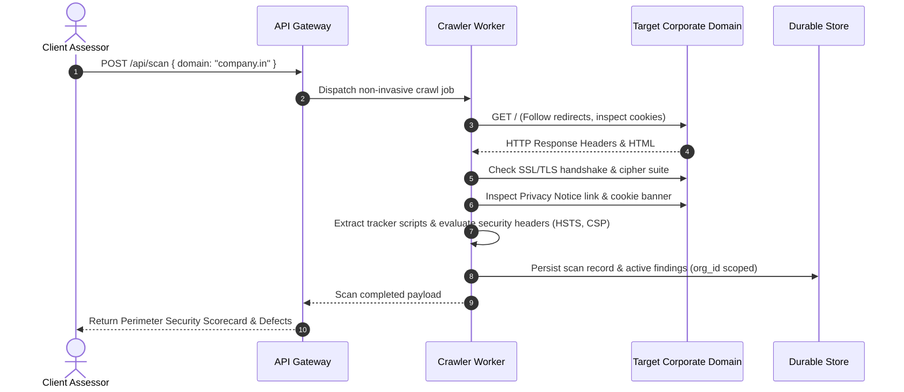
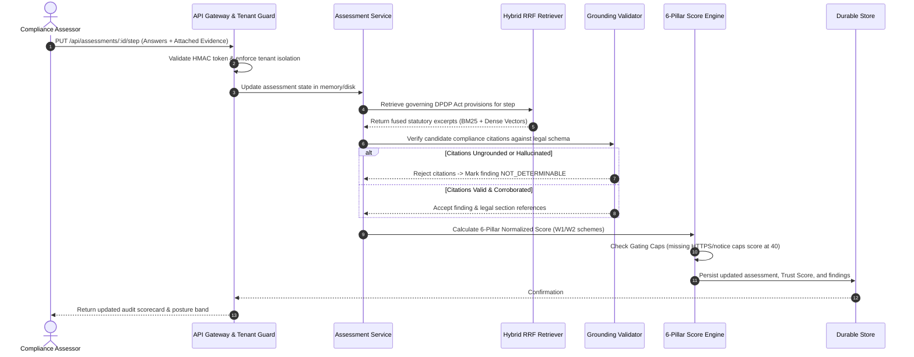
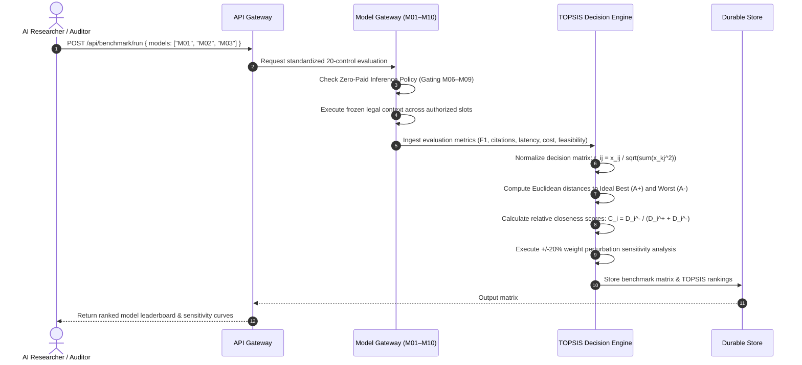

# TrustForge™ — Detailed Technical Architecture & Pipeline Data Flow Specification

This document provides an exhaustive, component-level architectural specification for **TrustForge**, detailing subsystem interactions, end-to-end data flows, multi-tenant security boundaries, and deterministic compliance scoring pipelines.

For a high-level executive overview, refer back to the [TrustForge README](../../README.md#system-architecture).

---

## 1. Architectural Philosophy & Separation of Concerns

TrustForge is architected upon strict decoupling principles to ensure auditability, data privacy, and mathematical determinism:

1. **Decoupled Compliance Evidence vs. Interpretation:**  
   Documentary evidence (policies, technical schemas, consent logs) and perimeter observations are ingested and hashed immutably via SHA-256 before being evaluated. Raw evidence cannot be modified by model reasoning.
2. **Statutory Grounding Gate Before Scoring:**  
   Language models do not generate arbitrary scores or legal determinations. Every model-derived finding must pass through a strict **Grounding Validator** that verifies legal section citations against the official gazetted DPDP Act 2023 corpus. Ungrounded citations or hallucinations are deterministically converted to `NOT_DETERMINABLE` or rejected before reaching the scoring engine.
3. **Deterministic Mathematical Scoring:**  
   The compliance Trust Score is computed through normalized, deterministic weighting formulas across six statutory pillars, incorporating critical failure gating caps (e.g., missing HTTPS or missing privacy notice forces $\min(TS, 40)$). Scores are fully reproducible and independent of stochastic LLM variance.
4. **Air-Gapped & Zero-Paid Inference Sovereignty:**  
   Sensitive corporate privacy data is never transmitted to paid commercial third-party LLM APIs. The system runs locally using Groq free-tier LPU endpoints, OpenRouter free tiers, or local Ollama weights, with commercial models (M06–M09) strictly gated under a zero-cost boundary ($0.00 spend).

---

## 2. Comprehensive Component & Data Flow Diagram

```mermaid
flowchart TD
    %% User Interfaces
    subgraph UI_Layer ["Presentation Tier (React 18 Single-Page Application)"]
        UI_Customer["Customer Compliance Workspace\n• Instant Perimeter Scanner (/scan)\n• 14-Step Statutory Audit Wizard (/assessment/wizard/*)\n• Real-Time Trust Score Radar & Analytics (/trust-score)\n• Vulnerability Findings Vault (/findings)\n• Cryptographic Evidence Locker (/evidence)\n• Remediation Roadmap & Milestones (/remediation)\n• Statutory Report & JSON Export Suite (/reports)\n• Citizen Rights Request Management Portal (/rights-portal)"]
        UI_Admin["Platform Admin Console (Isolated /admin/*)\n• Command Center & Global Telemetry (/admin/dashboard)\n• Cross-Tenant Analytics & Distribution (/admin/analytics)\n• Enterprise Tenant Directory (/admin/organizations)\n• User & Role Management (/admin/users)\n• Scan Dispatcher Queue Telemetry (/admin/scans)\n• Statutory Rules & Weights Matrix (/admin/rules)\n• System Health Diagnostics (/admin/health)\n• Immutable Security Audit Log (/admin/audit)"]
    end

    %% Security & API Gateway
    subgraph Gateway_Layer ["Application Gateway & Security Layer (Express.js / Node.js 22 LTS)"]
        AUTH_GATE["Authentication & Identity Gate\n• PBKDF2 Password Derivation (SHA-512, 10,000 iter, 16-byte salt)\n• HMAC-SHA256 Signed Session Token (tf_tok_...)\n• Timing-Safe Signature Comparison & 24h Expiration\n• Server-Verified Admin Role Assertion (platform_admin)"]
        TENANT_GATE["Multi-Tenant Isolation & Boundary Enforcer\n• Scoped org_id Injection into Request Context\n• Cross-Tenant Access Rejection (HTTP 403)\n• Rate Limiter & Defensive Request Sanitization"]
    end

    %% Compliance Subsystems
    subgraph Compliance_Layer ["Compliance Assessment & Evidence Subsystems"]
        SCANNER["Perimeter Security & Privacy Scanner\n• Automated Non-Invasive HTTP/HTTPS Crawl\n• Cookie Banner & Affirmative Consent Detection (§6(1))\n• Privacy Policy Accessibility Check (§5)\n• Transport Security (TLS 1.2/1.3, Cert Validity)\n• Defensive Security Headers (HSTS, CSP, X-Frame)\n• Third-Party Analytics & Tracker Script Inventory"]
        WIZARD["14-Step Statutory Assessment Wizard Engine\n• Steps 1–13: Statutory DPDP Act Chapters & Sections\n• Step 14: Pre-Submission Completeness Matrix\n• Automatic Validation & State Persistence"]
        EVIDENCE_MGR["Cryptographic Evidence Vault Manager\n• Ingestion SHA-256 Checksum Calculation\n• Forensic Tamper-Evident Chain of Custody\n• Text Chunking & RAG Corpus Ingestion"]
    end

    %% AI / RAG & Legal Intelligence Service
    subgraph AI_RAG_Layer ["Statutory RAG & Model Intelligence Service (Python 3.12 Backend)"]
        KNOWLEDGE["Official DPDP Act 2023 Statutory Corpus\n• 44 Sections across 9 Chapters + 2 Schedules\n• Canonical Chunking into Legal Provision Units\n• In-Memory BM25 Sparse Index + Dense Vector Store"]
        RRF_RETRIEVER["Hybrid Dense/Sparse Retrieval & RRF\n• Lexical BM25 Keyword Search (Exact Term Matching)\n• High-Dimensional Semantic Vector Cosine Similarity\n• Reciprocal Rank Fusion: RRF(d) = sum(1 / (60 + rank))\n• Top-K Context Window Assembly"]
        GATEWAY["10-Model Standardized Benchmark Gateway\n• Slot M01: OpenAI GPT-OSS 120B (Groq Free Tier)\n• Slot M02: OpenAI GPT-OSS 20B (Groq Free Tier)\n• Slot M03: Qwen3.8-27B (Groq Free Tier)\n• Slot M04: Gemma 4 31B (OpenRouter Free Tier)\n• Slot M05: Gemma 4 26B-A4B (OpenRouter Free Tier)\n• Slots M06–M09: Commercial Models (Strictly Gated)\n• Slot M10: Sarvam 30B (Local Ollama Slot)\n• Zero-Paid Inference Enforcer ($0.00 Commercial Spend)"]
        VALIDATOR["Statutory Citation Grounding Validator\n• Verifies Quoted Citations against Gazetted DPDP Act\n• Verbatim Excerpt Matching against Evidence Locker\n• Rejects Hallucinations (Ungrounded -> NOT_DETERMINABLE)"]
        TOPSIS["TOPSIS Multi-Criteria Decision Engine\n• 7 Primary Criteria (F1, Citations, Faithfulness, Consistency, Latency, Cost, Feasibility)\n• Vector Normalization: r_ij = x_ij / sqrt(sum(x_kj^2))\n• Euclidean Distance to Ideal Best (A+) and Worst (A-)\n• Relative Closeness Ranking: C_i = D_i^- / (D_i^+ + D_i^-)\n• +/-20% Weight Sensitivity Analysis"]
    end

    %% Scoring Engine
    subgraph Scoring_Layer ["Deterministic Trust Score Engine"]
        PILLARS["Six Canonical Compliance Pillars\n1. Privacy Architecture (w=0.20)\n2. Security Safeguards (w=0.20)\n3. Transparency & Notice (w=0.15)\n4. Governance & Accountability (w=0.15)\n5. Data Lifecycle Management (w=0.15)\n6. Data Principal Rights (w=0.15)"]
        GATING["Deterministic Gating & Posture Engine\n• Missing HTTPS -> min(TS, 40)\n• Missing Privacy Notice -> min(TS, 40)\n• Posture Bands: Low (0-39), Moderate (40-59), Good (60-79), Strong (80-100)\n• Dual Weights: W1 Penalty-Proportional & W2 Equal"]
    end

    %% Storage & Persistence
    subgraph Storage_Layer ["Durable Multi-Tenant Persistence Layer"]
        DB[("Durable Store (SQLite Engine)\n• Users & Authenticated Sessions\n• Organizations & Domain TXT Tokens\n• Assessments, Findings & Remediation Roadmaps\n• Benchmark Results & TOPSIS Historical Matrices\n• Optional Supabase PostgreSQL Client Adapter")]
        AUDIT[("Immutable Security Audit Ledger\n• Append-Only Log of Admin Actions\n• Actor IP, User ID, Timestamp & Resource\n• Exportable Audit Defense Records")]
        VAULT[("Local File Vault\n• Tenant-Isolated Evidence Folders\n• SHA-256 Verified Binary Storage")]
    end

    %% Inter-Layer Connections
    UI_Customer -->|HTTP / JSON + tf_tok_ Session Token| AUTH_GATE
    UI_Admin -->|HTTP / JSON + Admin Token| AUTH_GATE
    AUTH_GATE --> TENANT_GATE

    TENANT_GATE --> SCANNER
    TENANT_GATE --> WIZARD
    TENANT_GATE --> EVIDENCE_MGR

    SCANNER -.->|Detected Cookie & Security Deficiencies| DB
    EVIDENCE_MGR -->|Store Uploaded File| VAULT
    EVIDENCE_MGR -->|File Metadata & SHA-256| DB
    EVIDENCE_MGR -.->|Text Content Chunks| RRF_RETRIEVER

    WIZARD -->|Questionnaire Responses| PILLARS
    WIZARD -->|Statutory Retrieval Query| RRF_RETRIEVER

    KNOWLEDGE -->|Legal Corpus Chunks| RRF_RETRIEVER
    RRF_RETRIEVER -->|Fused Legal Context (RRF k=60)| GATEWAY
    GATEWAY -->|Candidate Findings & Citations| VALIDATOR
    VALIDATOR -->|Verified Statutory Findings| PILLARS
    VALIDATOR -->|Verified Findings| DB
    GATEWAY -.->|Model Performance Metrics| TOPSIS
    TOPSIS -.->|Model Ranks & Sensitivity| DB

    PILLARS --> GATING
    GATING -->|Final Trust Score & Posture Band| DB

    TENANT_GATE --> DB
    AUTH_GATE -.->|Security & Audit Events| AUDIT
```

---

## 3. End-to-End Execution Pipelines

### Pipeline 1: Non-Invasive Website Perimeter Scan


### Pipeline 2: 14-Step Statutory Assessment & Deterministic Scoring


### Pipeline 3: Multi-Model Benchmark & TOPSIS Decision Analysis


---

## 4. Multi-Tenant Security & Isolation Guarantees

1. **Authentication Architecture:**
   * Passwords derived using **PBKDF2** with `SHA-512`, `10,000` iterations, and a 16-byte cryptographically secure random salt generated via `crypto.randomBytes(16)`.
   * Session tokens formatted as `tf_tok_${payloadEncoded}.${signature}`, signed using `HMAC-SHA256` with a minimum 32-character application secret and 24-hour expiration TTL.
2. **Tenant Boundary Enforcement:**
   * Every database table partitions data by `org_id`.
   * Express middleware extracts `orgId` from the verified session payload and validates access on every read, write, and export route.
   * Cross-tenant access attempts immediately fail closed with `HTTP 403 Forbidden` and record an entry in the security audit ledger.
3. **Forensic Evidence Integrity:**
   * Files ingested into the evidence locker are hashed with `SHA-256` at the byte level.
   * Binary assets are stored in isolated per-tenant directories on disk, preventing path traversal or cross-tenant exposure.
