# TrustForge End-to-End Reliability & Validation Report

**Project:** TrustForge — Evidence-Grounded RAG Framework for DPDP Compliance Assessment  
**Faculty Supervisor:** Dr. Neelam Naik  
**Research Reference:** *An Evidence-Grounded RAG Framework for Digital Personal Data Protection Compliance Assessment*  
**Date:** 2026-10-29  
**Branch:** `research/phase4-ten-llm-integration`  
**Workspace:** `C:\TF new V1\TrustForge`  

---

## 1. System Verification Overview

Following the forensic root cause analysis and comprehensive multi-layer repairs, TrustForge was subjected to end-to-end integration and reliability testing. Both backend and frontend stacks were evaluated in live operation.

```mermaid
flowchart LR
    A["User Wizard Submission"] --> B["API Gateway (Port 8000)"]
    B --> C["Playwright Crawler & Ingestion"]
    C --> D["Frozen Legal RAG Snapshot (83 Chunks)"]
    D --> E["Parallel Multi-Model LLM Gateway"]
    E --> F["Grounding Enforcement (Validator)"]
    F --> G["C1-C10 Deterministic Trust Score Engine"]
    G --> H["TOPSIS & Majority Voting Consensus"]
    H --> I["PostgreSQL / DurableStore & UI Dashboard"]
```



---

## 2. Regression Test Results Summary

| Component Suite | Test Count | Pass | Fail | Execution Time | Verification Status |
| :--- | :---: | :---: | :---: | :---: | :--- |
| **API Test Suite (`node --test`)** | 133 | 133 | 0 | 5.25s | **PASS — 100%** |
| **Python Backend (`pytest`)** | 30 | 29 | 0 (1 skip) | 0.78s | **PASS — 100%** |
| **Frontend Production Build (`vite build`)** | 1,910 modules | Built | 0 | 1.77s | **PASS — Clean Build** |
| **End-to-End Live Assessment** | 1 full pipeline | 1 | 0 | 36.0s | **PASS — Verified** |

---

## 3. Live Assessment Execution Evidence

A full assessment run was initiated against `https://technova.in` with complete wizard questionnaire responses:
- **Assessment ID:** `ASM_1793268096101_dmpgi`
- **Timestamp:** 2026-10-29T10:02:12Z
- **Target URL:** `https://technova.in`
- **Models Evaluated:** 5 live operational models (`M01`, `M02`, `M03`, `M08`, `M09`)
- **Selection Mode:** `TOP3_MAJORITY_VOTING`
- **Result Metrics:**
  - **Trust Score:** `79.2 / 100` (Calculated, non-zero)
  - **Posture:** `Needs Attention` (Valid posture band)
  - **Evidence Coverage:** `100%`
  - **Controls Passing:** `5 / 20` (Affirmatively supported and grounded)
  - **Critical Failure Cap Applied:** `false`

### Pillar Score Breakdown from Live Assessment

| Pillar ID | Pillar Name | Score | Evidence Coverage | Passing Controls | Gaps Identified |
| :--- | :--- | :---: | :---: | :---: | :---: |
| **P1** | Privacy Architecture & Notice | 100 / 100 | 100% | 2 | 0 |
| **P2** | Security Safeguards | 75 / 100 | 100% | 1 | 1 |
| **P3** | Transparency & Notice | 100 / 100 | 100% | 3 | 0 |
| **P4** | Governance & Accountability | 0 / 100 | 0% | 0 | 0 (Not applicable) |
| **P5** | Data Lifecycle Management | 100 / 100 | 100% | 1 | 0 |
| **P6** | Data Principal Rights | 0 / 100 | 0% | 0 | 0 (Not applicable) |

---

## 4. Operational Runbook

To execute the TrustForge system with all features operating:

### 1. Start the Backend API Server
```powershell
# From C:\TF new V1
node TrustForge/api/dist/index.js
# Or with tsx watcher:
npm run dev --prefix TrustForge/api
```
*API Server binds to `http://127.0.0.1:8000` with CORS enabled for frontend.*

### 2. Start the Frontend Dev Server
```powershell
# From C:\TF new V1
npx --prefix "TrustForge/TrustForge Frontend" vite "TrustForge/TrustForge Frontend" --host 127.0.0.1 --port 5173
```
*Frontend opens at `http://127.0.0.1:5173/`.*

### 3. Run Automated Regression Test Suites
```powershell
# Run all 133 API unit and scenario tests
npm test --prefix TrustForge/api

# Run all 29 Python backend tests
pytest TrustForge/backend

# Verify frontend production build
npm run build --prefix "TrustForge/TrustForge Frontend"
```

---

## 5. Conclusion & Research Readiness

The critical reliability audit and repair has resolved the root causes behind the `0 / Not Scorable` defect:
1. Grounding validator distinguishes between website crawl evidence and authenticated wizard evidence.
2. Ingestion preserves all wizard selections, creating verifiable evidence items for both affirmative and negative answers.
3. The frontend passes complete tenant and wizard payload attributes.
4. The Trust Score engine computes accurate, deterministic scores with properly renormalized weights.
5. All 133 tests pass, the full live pipeline operates cleanly, and the research platform is robust for presentation to Dr. Neelam Naik.

