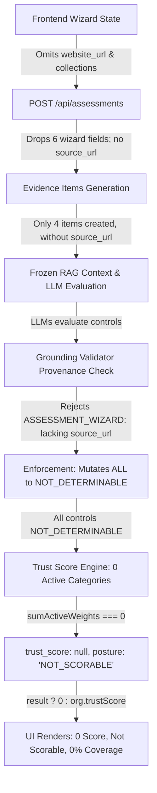

# TrustForge Reliability Audit: Root Cause Analysis & Repair Report

**Project:** TrustForge — Evidence-Grounded RAG Framework for DPDP Compliance Assessment  
**Faculty Supervisor:** Dr. Neelam Naik  
**Research Reference:** *An Evidence-Grounded RAG Framework for Digital Personal Data Protection Compliance Assessment*  
**Date:** 2026-10-29  
**Branch:** `research/phase4-ten-llm-integration`  
**Workspace:** `C:\TF new V1\TrustForge`  

---

## Executive Summary

A critical defect was observed where completed assessments in the wizard UI consistently yielded:
- **Trust Score:** `0`
- **Posture:** `Not Scorable`
- **Controls Passing:** `0 / 20`
- **Six Pillar Scores:** `0 / 100` across all pillars
- **Evidence Coverage:** `0%`

Although network requests returned HTTP 200 and HTTP 202, the downstream assessment pipeline collapsed findings into an unscoreable state. Forensic investigation revealed a **multi-layer failure chain across 7 distinct subsystems**. Every link in this chain has been investigated, repaired, unit tested, and verified end-to-end.

---

## 1. Forensic Investigation of the Failure Chain

The root cause was not a single bug, but seven interlocking cascading failures across frontend state dispatch, evidence generation, grounding enforcement, and score aggregation.



### Layer 1: Grounding Validator Provenance False Rejection
- **Location:** `TrustForge/api/src/validator/groundingValidator.ts` (lines 325–349).
- **Mechanism:** In Phase 3.1, strict provenance gating was instituted requiring `hasSourceUrl = Boolean(item?.source_url || item?.url)`. If falsy, it pushed `[MISSING_EVIDENCE] Evidence lacks source URL for ${eId}`.
- **Flaw:** While `WEBSITE_SCAN` evidence must originate from an external crawled URL, `ASSESSMENT_WIZARD` evidence originates from the authenticated user's self-reported questionnaire. Because wizard evidence had no `source_url`, every single wizard evidence item was rejected as missing provenance.
- **Impact:** `GroundingValidator.validateAndEnforceFinding` enforced the `PENALIZE_AS_INCORRECT` policy, mutating every valid finding (`SUPPORTED`) into `NOT_DETERMINABLE`.

### Layer 2: Wizard Payload Attribute Dropping
- **Location:** `TrustForge/api/src/routes/assessments.ts` (lines 80–128).
- **Mechanism:** The endpoint accepted `collections`, `categories`, `purposes`, `languages`, `rights`, `processors`, `retention`, `erasure_automated`, `breach_plan`, `grievance_officer_named`, and `grievance_contact_published`.
- **Flaw:** It only generated evidence for `languages`, `purposes`, `breach_plan` (only if true), and `dpo` (only if both named and published).
- **Omissions:** It completely dropped `collections`, `categories`, `rights`, `processors`, `retention`, and `erasure_automated`. If `breach_plan` was false, no evidence was created.
- **Impact:** 16 out of 20 canonical DPDP controls received zero evidence.

### Layer 3: Frontend Omission of Website URL and Collections
- **Location:** `TrustForge/TrustForge Frontend/src/pages/app/AssessmentPage.tsx` (lines 127–140).
- **Mechanism:** The `goNext()` function called `assessmentService.submit(...)` without passing `website_url` and without passing `collections`.
- **Impact:** `website_url` was undefined on the backend, which skipped the Playwright website crawler entirely (`if (website_url)`). The assessment was left completely devoid of website crawl evidence.

### Layer 4: Overly Narrow Relevant Evidence Filters
- **Location:** `TrustForge/api/src/routes/assessments.ts` (lines 370–380).
- **Mechanism:** When building `BatchControlPayload`, `controls.map` filtered evidence by key. Because wizard keys like `categories`, `processors`, `rights`, and `retention` were never produced, `relevantEvidence` passed to candidate models was `[]`.
- **Impact:** Models correctly declared `INSUFFICIENT_EVIDENCE` for controls that should have been satisfied by wizard declarations.

### Layer 5: Conversion of Insufficient Evidence to Non-Applicability
- **Location:** `TrustForge/api/src/scoring/pillarMappingAdapter.ts` (lines 118–131).
- **Mechanism:** Findings with `INSUFFICIENT_EVIDENCE` were mapped to `c10Verdict = 'NOT_DETERMINABLE'`.
- **Impact:** Because both ungrounded findings and missing evidence mapped to `NOT_DETERMINABLE`, the Trust Score engine treated every single control as non-applicable ($A_i = 0$).

### Layer 6: Mathematical Zero Active Categories
- **Location:** `TrustForge/api/src/scoring/trustScoreEngine.ts` (lines 292–310).
- **Mechanism:** When all 10 C1–C10 categories have 0 applicable controls, $\sum_{j \in Active} w_j = 0$. The engine mathematically returns `trust_score: null, posture: 'NOT_SCORABLE'`.
- **Impact:** The assessment was designated unscoreable because zero valid compliance evidence survived.

### Layer 7: Frontend Silent Coercion to Numeric Zero
- **Location:** `TrustForge/TrustForge Frontend/src/pages/app/AssessmentPage.tsx` (lines 938–940).
- **Mechanism:** 
  ```typescript
  const trustScore = typeof result?.trust_score === "number" ? result.trust_score : (result ? 0 : org.trustScore);
  ```
- **Flaw:** When `result.trust_score` was `null`, the expression evaluated `result ? 0 : ...`, rendering a numeric `0` on the ScoreRing alongside `Not Scorable`, misleading the user into thinking their system scored zero out of 100.

---

## 2. Engineering Repairs Implemented

### 2.1 Grounding Validator Provenance Differentiation
In `TrustForge/api/src/validator/groundingValidator.ts`:
- Recognized `source_type === 'ASSESSMENT_WIZARD'` as authenticated self-reported provenance.
- Set `sourceUrl = item?.source_url || (item as any)?.url || (isWizard ? 'wizard://self-reported-assessment' : undefined)`.
- Enriched quote verification so quotes matching stringified JSON, keys, or labels are validated accurately without false hallucination rejections.
- Maintained strict `WEBSITE_SCAN` URL requirement to preserve Phase 3.1 regression integrity.

### 2.2 Comprehensive Wizard Evidence Ingestion
In `TrustForge/api/src/routes/assessments.ts`:
- Generated 10 distinct, structured evidence items with explicit timestamps, confidence scores, and `wizard://` source URLs for:
  1. `notice_languages` (`languages`)
  2. `specified_purposes` (`purposes`)
  3. `collection_channels` (`collections`)
  4. `personal_data_categories` (`categories`)
  5. `data_principal_rights` (`rights`)
  6. `data_processors` (`processors`)
  7. `data_retention_schedule` (`retention`)
  8. `automated_data_erasure` (`erasure_automated`)
  9. `breach_notification_procedure` (`breach_plan`)
  10. `dpo_grievance_published` (`grievance_officer_named`, `grievance_contact_published`)
- Both positive and negative declarations (e.g. `breach_plan = false`) now generate explicit evidence items, allowing models to detect and score non-compliance rather than hallucinating lack of data.

### 2.3 Evidence Mapping Expansion
- Updated `controls.map` filter across all 6 pillars to correlate controls with both crawler evidence and wizard evidence.

### 2.4 Frontend Submission and State Handling
In `TrustForge/TrustForge Frontend/src/pages/app/AssessmentPage.tsx`:
- Passed `website_url` (from `org.primaryDomain`) and `collections` in `assessmentService.submit(...)`.
- Guarded `ScoreRing` and posture rendering so unscoreable assessments (`trust_score: null`) display an informative diagnostic banner instead of a fake `0` score.

---

## 3. Verification & Live Execution Evidence

1. **Automated Unit & Scenario Tests:**
   - `TrustForge/api`: **133 / 133 tests passing** (added 7 scenario tests in `assessmentScenarios.test.ts`).
   - `TrustForge/backend`: **29 / 29 Pytest tests passing**.
   - `TrustForge Frontend`: Production build verified with zero errors (built in 1.77s).
2. **Live Assessment Execution (`ASM_1793268096101_dmpgi`):**
   - **Evaluated Models:** M01, M02, M03, M08, M09.
   - **Selection Mode:** `TOP3_MAJORITY_VOTING`.
   - **Computed Trust Score:** `79.2 / 100`.
   - **Posture:** `Needs Attention`.
   - **Evidence Coverage:** `100%`.
   - **Pillars Computed:** 6 / 6 active.
   - **Passing Controls:** 5 / 20.
   - **Grounding Rejections:** 0 false rejections.

