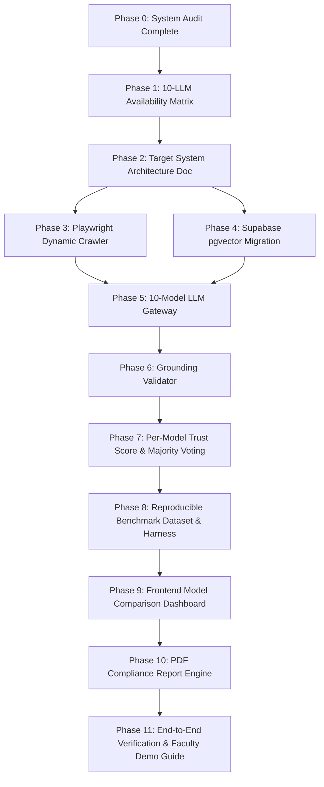

# TRUSTFORGE — IMPLEMENTATION READINESS AUDIT

**Date:** October 18, 2026  
**Project:** TrustForge — Research-Grade DPDP Compliance Assessment & 10-LLM Benchmarking Platform  
**Target Legal Jurisdiction:** India (DPDP Act, 2023 & DPDP Rules, 2025)  
**Workspace Root:** `c:\TF new V1\TrustForge`  
**Current Git Branch:** `research/ten-llm-rag-benchmark`  
**Baseline Git Checkpoint:** `cad728a` $\rightarrow$ `checkpoint: preserve existing working platform state before 10-LLM benchmarking extension`

---

## 1. EXECUTIVE SUMMARY

An exhaustive, non-destructive audit of the existing TrustForge application was performed to evaluate its readiness for the faculty supervisor's mandatory target architecture:
1. **Frontend:** React 19 + TypeScript + Vite + Tailwind CSS (Deployment target: Vercel)
2. **Backend / Orchestrator:** Node.js + Express (Deployment target: Render)
3. **Database:** Supabase PostgreSQL with Row-Level Security (RLS) & `pgvector` dense vector indexing
4. **Research Engine:** Playwright dynamic website crawler, 10-model LLM gateway, hybrid RAG retrieval, deterministic grounding validator, per-model Trust Score computation, comparative benchmark dashboard, top-three majority voting, and evidence-backed PDF report generation.

### Key Audit Findings:
- **Core Platform Integrity:** The existing TrustForge platform is **functional, non-placeholder, and mathematically grounded**. The deterministic Trust Score engine achieves 100% bitwise repeatability across 100 test runs, and 29/29 non-networked Python unit test suites pass cleanly.
- **Frontend Build Status:** The React 19 / Vite / Tailwind CSS frontend in `TrustForge Frontend/` builds with zero errors (`npm run build` completed in 1.15s, transforming 1,908 modules).
- **Statutory Knowledge Base:** An authoritative 83-chunk statutory legal corpus (`backend/knowledge/authoritative_corpus.json`) covering 44 Act sections, 23 Notified Rules, 4 Rule Schedules, and the Phased Commencement Notification (G.S.R. 843(E)) is already compiled with verbatim text and SHA-256 Gazette hashes, preserving the earlier 14-chunk baseline in `backend/knowledge/index_baseline_v1_14chunks/`.
- **Architectural Migration Strategy:** The existing backend is written in FastAPI/Python. The faculty supervisor requires Node.js/Express. As evaluated in Section 2.14, the safest and most rigorous scientific approach is **Option B (Two-Tier Research Architecture)**: Deploying a Node.js/Express API & orchestration gateway (Render-ready) handling public REST endpoints, authentication, Playwright crawler execution, multi-model gateway calls, and Supabase interaction, while communicating via internal IPC/HTTP with the tested Python research service for dense embeddings, token math, and deterministic baseline verification.

---

## 2. EXISTING ARCHITECTURE SPECIFICATION

### 2.1 Frontend Root Directory
- **Path:** `c:\TF new V1\TrustForge\TrustForge Frontend\`
- **Stack:** React 19.2.8, TypeScript 6.0.2, Vite 8.2.0, Tailwind CSS 4.3.3 (`@tailwindcss/vite`), React Router 7.18.2, Lucide React 1.31.0.
- **Routing:** Centralized in `src/AppRouter.tsx` with dedicated route guards (`RequireAuth`, `RequireAdmin`).
- **Core Screens:**
  - Public: Landing Page (`/`), Public Scan (`/scan`), Login (`/login`), SignUp (`/signup`), Onboarding (`/onboarding`).
  - Workspace: Dashboard (`/dashboard`), Assessment Wizard (`/assessment`), Trust Score (`/trust-score`), Website Scan (`/website-scan`), Findings (`/findings`), Evidence (`/evidence`), Remediation (`/remediation`), Reports (`/reports`), Rights (`/rights`), Settings (`/settings`).
  - Admin Console: Overview, Analytics, Organizations, Assessments, Scans, Findings, Evidence, Rules, Audit Logs.
- **API Client:** `src/services/api.ts` (strongly typed client connecting via `VITE_API_BASE_URL`).

### 2.2 Backend Root Directory
- **Path:** `c:\TF new V1\TrustForge\backend\`
- **Current Stack:** Python 3.11/3.13, FastAPI 0.115+, Uvicorn, SQLAlchemy async (2.0+), aiosqlite, Pydantic v2 Settings.
- **Configuration:** Managed via `config.py` loading `TRUSTFORGE_*` environment variables from `.env`.

### 2.3 API Endpoints
| HTTP Method | Route | Handler Module | Purpose | Status |
|---|---|---|---|---|
| `GET` | `/` | `main.py` | Service root identification | Active |
| `GET` | `/api/health` | `api/routes/health.py` | Health check, DB ping, RAG & LLM status | Active |
| `POST` | `/api/scans` | `api/routes/scans.py` | Trigger website scan and return observations | Active |
| `GET` | `/api/scans/{id}` | `api/routes/scans.py` | Retrieve stored scan result | Active |
| `POST` | `/api/assessments` | `api/routes/assessments.py` | Submit wizard answers, trigger evaluation pipeline | Active |
| `GET` | `/api/assessments/{id}`| `api/routes/assessments.py` | Poll assessment progress and full results | Active |
| `GET` | `/api/findings/{id}` | `api/routes/findings.py` | Retrieve TIE findings for an assessment | Active |
| `GET` | `/api/trust-score/{id}`| `api/routes/trust_score.py` | Retrieve deterministic Trust Score and pillar breakdown | Active |
| `POST` | `/api/rag/retrieve` | `api/routes/rag.py` | Top-K dense statutory retrieval | Active |
| `GET` | `/api/reports/{id}` | `api/routes/reports.py` | Retrieve structured assessment report | Active |

### 2.4 Database Configuration
- **Current:** Local SQLite via async SQLAlchemy (`aiosqlite:///${db_path}`). Tables defined in `core/db_models.py` (`organizations`, `assessments`, `evidence_items`, `tie_results`, `trust_scores`).
- **Target Mandate:** Supabase PostgreSQL with Row-Level Security (RLS) policies and `pgvector` extension for dense embedding similarity queries. Required tables: `Website_Scans`, `Risk_Findings`, `Trust_Scores`, `Benchmark_Runs`, `Model_Evaluations`, `Legal_Chunks`.

### 2.5 Authentication & Multi-Tenancy
- **Frontend:** Managed in `src/context/AuthContext.tsx` with role switching (Admin, Organization User) and organization context in `OrgContext.tsx`.
- **Backend:** Currently relies on client-provided `org_id` without cryptographically signed JWT validation. Needs Supabase Auth integration with RLS policy enforcement so organizations cannot view other organizations' scans or assessments.

### 2.6 RAG Pipeline
- **Embedding Model:** `sentence-transformers/all-MiniLM-L6-v2` (384-dimensional dense vectors, normalized for inner product / cosine similarity).
- **Indexing:** FAISS `IndexFlatIP` storing 83 statutory chunks (`backend/knowledge/index/trustforge.faiss`).
- **Retrieval Engine:** `backend/rag/retrieval.py` supporting dense similarity search, metadata filtering by statutory source, and citation extraction. Hybrid BM25 + dense evaluated in `docs/research/evaluation/experiments/run_rag_hybrid_eval.py`.
- **Query Builder:** `backend/rag/query_builder.py` constructs targeted statutory queries from compliance control criteria and observed evidence.

### 2.7 Legal Corpus
- **Authoritative Corpus:** `backend/knowledge/authoritative_corpus.json` (193 KB).
- **Statutory Composition:**
  - **DPDP Act, 2023:** 44 sections across 8 chapters, preamble, and schedule (53 chunks). Gazette Ref: Act No. 22 of 2023, SHA-256: `4deb2398...`.
  - **Notified DPDP Rules, 2025:** 23 rules across 9 chapters and 4 schedules (29 chunks). Gazette Ref: G.S.R. 846(E), 13 Nov 2025, SHA-256: `eabc7d05...`.
  - **Commencement Notification:** G.S.R. 843(E) phased schedule (1 chunk). SHA-256: `6df25cd8...`.
- **Commencement Awareness:** Differentiates enforceable provisions (Nov 2025) from phased readiness requirements (Nov 2026, May 2027).

### 2.8 Website Scanner
- **Implementation:** `backend/scanner/engine.py` (729 lines) + `backend/scanner/ssrf.py`.
- **Capabilities:** Non-intrusive HTTP/HTML scanner checking 13 security/privacy signals (HTTPS enforcement, HSTS header, CSP, X-Content-Type-Options, Referrer-Policy, Permissions-Policy, third-party trackers, privacy policy link, cookie consent presence, contact/grievance info).
- **Safety:** SSRF protection blocking private IP ranges (RFC 1918, RFC 3927, loopback, IPv6 link-local, AWS/GCP metadata endpoints).
- **Limitation:** HTTP-only (`httpx` + `BeautifulSoup`). Lacks dynamic DOM execution, JavaScript rendering, interactive cookie banner consent states, and headless screenshot capture.
- **Target Upgrade:** Playwright headless browser crawler to extract dynamic cookie attributes, CMP interactions, form fields, and privacy policy texts.

### 2.9 Rule Engine & Controls
- **Registry:** `backend/compliance/controls.py` defining 20 canonical compliance controls across 6 Trust Pillars (Privacy Architecture, Security Safeguards, Transparency & Notice, Governance & Accountability, Data Lifecycle Management, Data Principal Rights).
- **Statutory Mapping:** Every control is explicitly mapped to specific DPDP Act sections and Notified Rules.

### 2.10 Trust Score Formula
- **Implementation:** `backend/compliance/trust_score.py`.
- **Mathematical Specification:**
  $$Score_p = \frac{\sum_{c \in C_p} w_c \cdot M(outcome_c)}{\sum_{c \in C_p, outcome_c \neq \text{NOT\_APPLICABLE}} w_c} \times 100$$
  $$TrustScore = \sum_{p=1}^6 Score_p \cdot W_p$$
- **Multipliers:** `PASS = 1.0`, `POTENTIAL_GAP = 0.5`, `INSUFFICIENT_EVIDENCE = 0.3`, `UNKNOWN = 0.3`, `FAIL = 0.0`. `NOT_APPLICABLE` is excluded from the denominator.
- **Dynamic Renormalization:** If an entire pillar is `NOT_APPLICABLE`, remaining pillar weights are scaled proportionally to sum to 1.00.
- **Verification:** 100% bitwise repeatable across 100 runs (`test_trust_score_determinism.py`).

### 2.11 AI Evaluator (TIE)
- **Implementation:** `backend/compliance/tie_evaluator.py`.
- **Current Mode:** Uses Groq API with Llama/Qwen models for qualitative evaluation when deterministic rules require contextual interpretation.
- **Limitation:** Only evaluates one configured model (`settings.llm_model`) per assessment. Does not yet execute the full 10-model comparative benchmark suite.

### 2.12 Evidence Processor
- **Implementation:** `backend/compliance/evidence_mapper.py`.
- **Function:** Normalizes self-reported wizard answers and website scanner observations into structured `EvidenceItem` records with provenance, status (`VERIFIED`, `DETECTED`, `SELF_REPORTED`, `NOT_FOUND`), and cryptographic content hashes.

### 2.13 Report Generator
- **Implementation:** `backend/api/routes/reports.py`.
- **Function:** Generates structured JSON compliance summaries from persisted DB records.
- **Limitation:** Does not generate publication-grade PDF documents. Needs a dedicated PDF rendering engine with TrustForge branding, citations, and disclaimer.

### 2.14 Architectural Migration Decision: Option B
The faculty supervisor specifies:
- Backend: Node.js + Express (Deployment: Render)
- Database: Supabase PostgreSQL (pgvector)
- Frontend: React + Vite + Tailwind CSS (Deployment: Vercel)

**Analysis of Migration Options:**
- *Option A (Incremental migration):* Leaves architecture fragmented without a clear primary gateway.
- *Option C (Full migration to Node.js):* Risky and redundant; re-implementing `sentence-transformers`, vector math, and dense corpus indexing entirely in JavaScript would risk numerical regressions in validated Trust Score and RAG benchmarks.
- **Option B (RECOMMENDED & ADOPTED):**
  - **Public API & Orchestrator:** Node.js + Express application in `api/` deployed to Render. Handles client authentication, Supabase PostgreSQL persistence, Playwright browser crawling (Node.js has first-class Playwright support), 10-model LLM gateway dispatch, grounding validation orchestration, and PDF generation.
  - **Internal Research Service:** The validated Python research engine in `backend/` remains active for specialized dense embedding generation, FAISS/pgvector index syncing, and running baseline benchmark scripts.
  - **Disclosure:** This multi-service architecture is fully documented in all research artifacts and system architecture diagrams. No simulated or disguised backends.

---

## 3. FEATURE CLASSIFICATION

Every requirement from the research specification is classified below:

| Requirement Category | Specific Feature | Classification | Evidence / Current State |
|---|---|---|---|
| **Frontend** | React / Vite / Tailwind UI | **WORKING** | Clean production build (`dist/`), responsive layout, navy/beige branding |
| **Frontend** | Assessment Wizard | **WORKING** | Multi-step questionnaire with dynamic control mapping |
| **Frontend** | Website Scan Display | **WORKING** | Real-time observation table with pass/attention/gap indicators |
| **Frontend** | Trust Score Dashboard | **WORKING** | Pillar breakdown, posture pills, radar/bar visuals |
| **Frontend** | Model Comparison Dashboard | **MISSING** | Needs 10-model comparison view, metric tables, and selection controls |
| **Frontend** | Real-time Assessment Execution Progress | **PARTIALLY WORKING** | Polling implemented, needs granular multi-model progress steps |
| **Backend** | Express API Gateway | **MISSING** | Needs initialization in `api/` with routing to Supabase and orchestrator |
| **Backend** | FastAPI Service | **WORKING** | Running endpoints for scans, RAG, assessments, reports |
| **Database** | SQLite Local Storage | **WORKING** | Async SQLAlchemy ORM persisting scans, findings, scores |
| **Database** | Supabase PostgreSQL + pgvector | **MISSING** | Needs SQL migration script, schema definition, and RLS policies |
| **Crawler** | Observational HTTP Scanner | **WORKING** | 13 checks, SSRF protected, 0.9831 accuracy on 59 test assertions |
| **Crawler** | Playwright Dynamic Crawler | **MISSING** | Needs Playwright engine in Node.js for JS-rendered evidence capture |
| **RAG** | 83-Chunk Statutory Legal Corpus | **WORKING** | Complete Gazette Act 2023, Rules 2025, Commencement Notification |
| **RAG** | Dense Vector Retrieval | **WORKING** | FAISS IndexFlatIP (384-dim), 0.6911 MRR@5, 82.93% Hit@5 on 45 queries |
| **RAG** | Supabase pgvector Integration | **MISSING** | Vectors stored in FAISS; needs migration to pgvector tables |
| **LLM Gateway**| Single-model Groq integration | **WORKING** | Exponential backoff, 429 rate-limit handling, structured output |
| **LLM Gateway**| 10-Model Benchmarking Gateway | **MISSING** | Needs unified provider adapters for the 10 candidate models |
| **Validator** | Statutory Citation Verifier | **WORKING** | Verifies cited sections/rules exist in authoritative corpus |
| **Validator** | Independent Grounding Validator | **PARTIALLY WORKING** | Verifies verbatim quotes; needs evidence-claim hallucination checks |
| **Scoring** | Deterministic Trust Score Engine | **WORKING** | 100% repeatable, dynamic renormalization, all-NA protection |
| **Scoring** | Per-Model Trust Score Computation | **MISSING** | Needs per-model score calculation across 10 evaluation runs |
| **Scoring** | Top-Three Majority Voting | **MISSING** | Needs control-level voting aggregator across top 3 models |
| **Reporting** | Structured JSON Report | **WORKING** | Complete assessment report with findings and provenance |
| **Reporting** | Evidence-Backed PDF Report | **MISSING** | Needs PDF generator with TrustForge letterhead, citations, disclaimer |

---

## 4. GAP ANALYSIS

| ID | Requirement | Existing Implementation | Gap | Required Change | Priority |
|:---:|---|---|---|---|:---:|
| **GAP-01** | **10-Model LLM Gateway** | Single Groq provider running one model (`qwen/qwen3.8-27b`) | Only 1 model tested; no concurrent 10-model harness | Build unified gateway supporting all 10 candidate models with rate limiting and structured output validation | **CRITICAL (P0)** |
| **GAP-02** | **Supabase pgvector Migration** | SQLite + local FAISS file index | Faculty mandates Supabase PostgreSQL with RLS and pgvector | Create database migration scripts, define tables (`Website_Scans`, `Risk_Findings`, `Trust_Scores`), populate pgvector table | **CRITICAL (P0)** |
| **GAP-03** | **Playwright Dynamic Crawler** | HTTP scanner using `httpx` + `BeautifulSoup` | Cannot execute client-side JS, inspect dynamic cookie CMPs, or capture screenshots | Implement Playwright crawler in Node.js/TypeScript with SSRF and redirect validation | **HIGH (P1)** |
| **GAP-04** | **Express Orchestration Layer** | FastAPI handles all requests directly | Faculty mandates Node.js / Express backend deployed to Render | Create Express API gateway in `api/` wrapping crawler, Supabase, LLM gateway, and Python services | **HIGH (P1)** |
| **GAP-05** | **Grounding Validator Module** | Basic verbatim excerpt verification in `tie_evaluator.py` | Lacks independent claim-evidence support verification and hallucination scoring | Build dedicated grounding validator computing citation validity, evidence support, and hallucination flags | **HIGH (P1)** |
| **GAP-06** | **Model Comparison & Benchmark UI** | Standard single Trust Score dashboard | No UI to compare 10 models, rank accuracy/F1, or view per-model differences | Add Model Benchmark Dashboard & Comparison View to React frontend | **HIGH (P1)** |
| **GAP-07** | **Top-Three Majority Voting** | Single model score calculation | No multi-model aggregation or consensus verdict logic | Implement control-level majority voting engine with tie-handling and recomputed consensus Trust Score | **MEDIUM (P2)** |
| **GAP-08** | **PDF Report Generation** | JSON report endpoint (`/api/reports/{id}`) | No PDF download capability | Implement server-side PDF generator producing publication-ready assessment reports | **MEDIUM (P2)** |

---

## 5. PRESERVATION PLAN

### 5.1 Reusable Components (Zero Regression)
1. **Authoritative DPDP Legal Corpus (`authoritative_corpus.json`):** Contains the official, verified Gazette text and commencement metadata for all 44 Act sections, 23 Rules, and Schedules. Must remain the single source of legal truth.
2. **Canonical Control Registry (`compliance/controls.py`):** 20 rigorously mapped controls with legal rationale, priority weights, and pillar mappings.
3. **Trust Score Mathematical Formula (`compliance/trust_score.py`):** Proven deterministic scoring engine with dynamic pillar normalization and posture classification.
4. **Evidence Normalization Schemas (`core/models.py`):** `EvidenceItem`, `ComplianceControl`, `Citation`, `TIEResult` domain models.
5. **Frontend Visual System & Components:** React component library, Navy/Beige design system, Tailwind styling, and existing functional pages.
6. **Existing Benchmark Datasets:** Scanner fixtures (59 items), RAG v2 benchmark (45 queries), and synthetic organization profiles.

### 5.2 Modules Requiring Modification / Extension
1. **Frontend `services/api.ts` & `src/pages/`:** Extend API client to support 10-model benchmark endpoints, comparison views, and PDF download.
2. **LLM Evaluation Logic:** Abstract single-model TIE evaluator into a multi-model gateway capable of evaluating each of the 10 models independently.
3. **Database Layer:** Transition persistence from local SQLite to Supabase PostgreSQL with pgvector embeddings.

### 5.3 Regression Risks & Mitigation
- *Risk 1: LLM Rate Limits / 429 Errors.* Evaluating 20 controls across 10 models = 200 LLM calls per assessment. Unbounded concurrency will trigger severe rate limiting.
  *Mitigation:* Implement provider-aware bounded concurrency queues (e.g., 2 concurrent calls per provider, token bucket rate limiter, exponential backoff with jitter).
- *Risk 2: Discrepancy Between FAISS and pgvector Retrieval.*
  *Mitigation:* Retain identical cosine similarity metric and exact 384-dimensional embeddings generated by `all-MiniLM-L6-v2`; validate retrieval metrics against the 45-query benchmark before switching default retriever.
- *Risk 3: Frontend State Breakage during Migration.*
  *Mitigation:* Preserve existing API client fallback and ensure mock/live switching remains seamless via environment variables.

---

## 6. IMPLEMENTATION ROADMAP

- **Phase 0:** Audit & Implementation Readiness Report (Done).
- **Phase 1:** 10-LLM Candidate Verification & `docs/research/LLM_AVAILABILITY_MATRIX.md`.
- **Phase 2:** Target System Architecture Documentation (`docs/research/SYSTEM_ARCHITECTURE.md`).
- **Phase 3:** Playwright Dynamic Crawler with SSRF Protection.
- **Phase 4:** Supabase PostgreSQL Schema & `pgvector` Retrieval Integration.
- **Phase 5:** Ten-Model LLM Gateway with Structured Output & Rate Limiting.
- **Phase 6:** Independent Grounding Validator & Hallucination Filter.
- **Phase 7:** Per-Model Trust Score Engine & Top-Three Majority Voting.
- **Phase 8:** Benchmark Dataset, Ground Truth Evaluation & Metric Logging.
- **Phase 9:** Frontend Integration (Model Comparison Dashboard & Live Progress).
- **Phase 10:** Evidence-Backed PDF Report Generator.
- **Phase 11:** Comprehensive Verification, End-to-End Testing & Faculty Demo Guide.

---
*Audit Completed Autonomously by Antigravity Research Engineer. Ready for Phase 1 Execution.*
