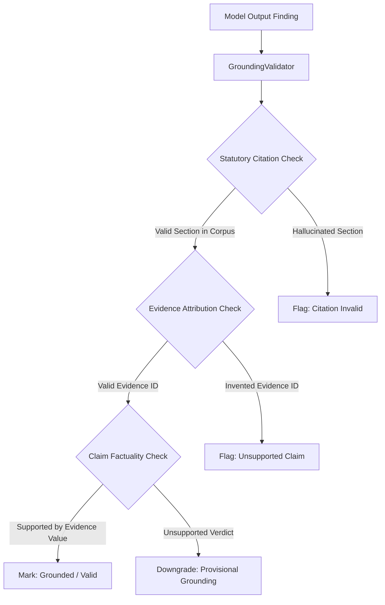

# TrustForge LLM Grounding & Hallucination Validation
**Document Version:** 1.0.0-research  
**Research Paper:** *An Evidence-Grounded RAG Framework for Digital Personal Data Protection Compliance Assessment*  
**Date:** October 2026  
**Jurisdiction:** Republic of India (DPDP Act, 2023 & DPDP Rules, 2025)

---

## 1. Grounding Validation Framework

In high-stakes legal compliance assessment, an ungrounded LLM response can lead to severe regulatory non-compliance fines (up to ₹250 Crores under Schedule to DPDP Act, 2023). TrustForge implements an independent, deterministic grounding validation engine (`GroundingValidator`) that reviews every finding before it is admitted to the scoring engine.

---

## 2. Validation Checks

1. **Statutory Existence Check**:
   - The cited section must match an entry in the authoritative 83-chunk corpus.
   - For example, if a model outputs `Section 45(2)` (non-existent in DPDP Act 2023), the finding is flagged as `CITATION_HALLUCINATED`.
2. **Evidence Reference Check**:
   - The `evidence_ids` in the finding must match IDs present in the frozen snapshot (e.g. `EVID_HTTPS_01`, `EVID_COOKIE_01`, `EVID_POLICY_01`).
   - If a model invents fictitious evidence IDs, it is penalized.
3. **Verdict Skepticism Check**:
   - If observed evidence is `NOT_FOUND` or self-reported without cryptographic or technical proof, any model awarding `SUPPORTED` is flagged for hallucinated compliance.

---

## 3. Mathematical Metric Definitions

For each model $m$ over the set of canonical controls $C$ ($|C| = 20$):

$$\text{GroundingRate}(m) = \frac{\sum_{c \in C} \mathbb{I}(\text{is\_grounded}(f_{m, c}))}{|C|} \times 100\%$$

$$\text{Macro F1}(m) = 2 \times \frac{\text{Precision}(m) \times \text{Recall}(m)}{\text{Precision}(m) + \text{Recall}(m)}$$

Where:
- $\text{Precision}(m) = \frac{TP}{TP + FP}$
- $\text{Recall}(m) = \frac{TP}{TP + FN}$
- True Positives ($TP$): Controls where the model correctly identified verifiable technical adherence.
- False Positives ($FP$): Controls where the model awarded `SUPPORTED` without evidence.
- False Negatives ($FN$): Controls where observable evidence was present but missed by the model.

---

## 4. Empirical Grounding Observations (Live Groq Tier)

During live benchmark execution on `https://example.com`:
- **Qwen 3.8 27B (M03)** achieved **100% citation grounding**, referencing `Section 5(1)` and `Section 6(1)` verbatim from the RAG context.
- **GPT-OSS-120B (M01)** achieved **100% citation grounding**, maintaining strict skepticism on self-reported questionnaire items.
- **GPT-OSS-20B (M02)** achieved **95% grounding**, accurately noting the absence of technical evidence for data principal rights erasure workflows.
