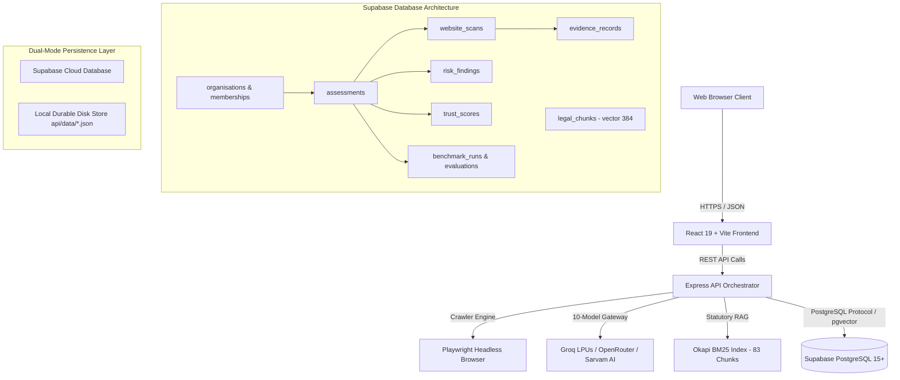

# TrustForge — Phase 1: Supabase PostgreSQL Architecture
**Document ID:** `docs/research/PHASE1_SUPABASE_ARCHITECTURE.md`  
**Research Title:** *An Evidence-Grounded RAG Framework for Digital Personal Data Protection Compliance Assessment*  
**Jurisdiction:** Republic of India (DPDP Act, 2023 & Notified DPDP Rules, 2025)  
**Date:** October 2026

---

## 1. System Architecture Overview

TrustForge employs a decoupled, multi-tier software system designed for public compliance auditing and research-grade comparative model benchmarking:

---

## 2. Core Relational Entities & Data Schema

The schema definition in `database/migrations/002_comprehensive_schema_and_rls.sql` establishes:

### 2.1 Principal Paper Entities (Mandated by Faculty)
1. **`public.website_scans`**:
   - `id TEXT PRIMARY KEY`: Canonical scan identifier (`SCAN_...`).
   - `assessment_id TEXT REFERENCES assessments(id)`: Relates technical scan to parent assessment.
   - `target_url TEXT NOT NULL`: Target website audited.
   - `scan_checks JSONB`: Array of technical inspection items (TLS, CSP, HSTS, Cookies, Policy links).
   - `evidence_items JSONB`: Captured technical evidence values.
   - `preliminary_score INT`: Baseline readiness score.
2. **`public.risk_findings`**:
   - `id UUID PRIMARY KEY DEFAULT gen_random_uuid()`: Unique finding row.
   - `assessment_id TEXT REFERENCES assessments(id)`: Parent assessment.
   - `control_id TEXT NOT NULL`: Canonical DPDP control identifier (e.g. `TF-PRIV-001`).
   - `model_id TEXT NOT NULL`: Foundation model attribution (`M01`–`M10` or `TOP3_CONSENSUS`).
   - `verdict TEXT NOT NULL`: `SUPPORTED`, `PARTIALLY_SUPPORTED`, `NOT_SUPPORTED`, `INSUFFICIENT_EVIDENCE`, `NOT_APPLICABLE`.
   - `severity TEXT NOT NULL`: `LOW`, `MEDIUM`, `HIGH`, `CRITICAL`.
   - `citations JSONB`: Verbatim statutory quotes and Gazette section references.
   - `is_grounded BOOLEAN`: Independent deterministic grounding verification flag.
3. **`public.trust_scores`**:
   - `id UUID PRIMARY KEY DEFAULT gen_random_uuid()`: Score computation record.
   - `assessment_id TEXT REFERENCES assessments(id)`: Parent assessment.
   - `model_id TEXT NOT NULL`: Model attributing the score.
   - `trust_score NUMERIC(5,2)`: Deterministic score (0.00–100.00).
   - `posture TEXT NOT NULL`: Compliance band (`Strong Alignment`, `Needs Attention`, `Potential Gaps`, `Critical`).
   - `pillar_scores JSONB`: Multi-pillar compliance vector.
   - `evidence_coverage NUMERIC(5,2)`: Percentage of affirmative technical evidence observed.

### 2.2 Supporting Relational Entities
- **`organisations` & `organisation_memberships`**: Provides multi-tenant data isolation and role-based permissions (`Owner`, `Admin`, `Compliance Officer`, `Auditor`, `Viewer`).
- **`assessments`**: Manages the complete lifecycle of authenticated assessments, progress tracking, and model synthesis modes.
- **`evidence_records`**: Normalized technical artifacts with SHA-256 cryptographic provenance.
- **`benchmark_runs` & `model_evaluations`**: Detailed research execution logs, latency measurements, and prompt context hashes.
- **`legal_documents` & `legal_chunks`**: The authoritative Gazette knowledge base with 384-dimensional vector embeddings.

---

## 3. Storage Mode & Fallback Strategy

The application provides dual-mode operational resilience via `api/src/database/supabaseClient.ts`:
- **`DATABASE_MODE=supabase`**: When `SUPABASE_URL` and `SUPABASE_SERVICE_ROLE_KEY` (or `SUPABASE_ANON_KEY`) are present, operations use Cloud PostgreSQL directly.
- **`DATABASE_MODE=local`**: When running in offline or local research mode, the application utilizes `durableStore.ts` with local disk persistence (`api/data/*.json`).
- **Write Mirroring**: In Supabase mode, successful writes mirror to the local store to allow seamless offline inspection and disaster recovery without data loss.

---

## 4. Multi-Tenant Row-Level Security (RLS)

All tables in the `public` schema have Row-Level Security enabled (`ALTER TABLE ... ENABLE ROW LEVEL SECURITY`). Access policies enforce:
- **Tenant Isolation**: An organization's assessments, scans, evidence, findings, and scores can only be read or modified by authenticated users possessing verified membership in that organization.
- **Public Legal Knowledge**: `legal_documents` and `legal_chunks` are globally readable by all users and anonymous clients.
- **Free Public Scans**: `website_scans` with `organisation_id IS NULL` are readable by unauthenticated users, while private enterprise assessments require authorization.
