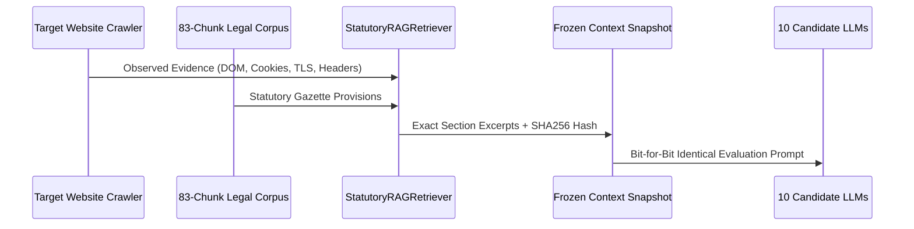

# TrustForge RAG Benchmark Protocol
**Document Version:** 1.0.0-research  
**Research Paper:** *An Evidence-Grounded RAG Framework for Digital Personal Data Protection Compliance Assessment*  
**Date:** October 2026  
**Jurisdiction:** Republic of India (DPDP Act, 2023 & DPDP Rules, 2025)

---

## 1. Statutory Retrieval Methodology

Scientific evaluation of compliance cannot rely on open-ended LLM pre-training memory, as models frequently hallucinate section numbers, confuse GDPR principles with Indian statutory provisions, or cite repealed Draft Bills (e.g. PDPB 2019).

TrustForge implements **Evidence-Grounded Retrieval-Augmented Generation (RAG)**:



### 1.1 The Authoritative 83-Chunk Legal Corpus
The knowledge base (`backend/knowledge/authoritative_corpus.json`) contains **83 curated legal chunks** derived from:
1. **The Digital Personal Data Protection Act, 2023** (Act No. 22 of 2023, Ministry of Law and Justice, Gazette of India).
2. **The Notified Digital Personal Data Protection Rules, 2025** (Ministry of Electronics and Information Technology, GSR Notifications).
3. **Statutory Commencement Schedules**: Distinguishing currently enforceable sections from conditional or deferred rules.

---

## 2. Frozen Snapshot Integrity

To guarantee that all 10 candidate models receive bit-for-bit identical statutory inputs:
1. For each of the **20 Canonical DPDP Controls**, `StatutoryRAGRetriever` performs exact section mapping (e.g. `Section 5(1)`, `Section 6(1)`, `Section 8(5)`, `Section 9(1)`).
2. The retrieved passages, control mandates, and evidence items are concatenated into a canonical evaluation string.
3. A cryptographic **SHA-256 hash** is computed and attached to the assessment record:
   ```
   Snapshot Hash: b9cec8432e23a7c813aec6499e3b21816b1a54fe34b7fc8e7d7c816b6dbc00d6
   Corpus Version: 83-chunk-authoritative-v2
   ```
4. This hash must match across all 10 model execution logs for any given assessment run, establishing experimental reproducibility.

---

## 3. Experimental Reproducibility Protocol

To reproduce any benchmark experiment:
```bash
# 1. Execute live Groq & RAG verification script
cd "C:\TF new V1\TrustForge\api"
npx tsx test_20_controls_live.ts

# 2. Execute full end-to-end evaluation pipeline with restart recovery
npx tsx test_e2e_assessment.ts
```

All benchmark runs are persisted to disk at `api/data/benchmarks.json` and are accessible via:
- `GET /api/benchmark/latest`: Returns latest run with per-model scores and metrics.
- `GET /api/benchmark/:id`: Retrieves historical evaluation by benchmark run ID.
- `GET /api/benchmark/models`: Returns real-time provider entitlement and operational availability.
