# TRUSTFORGE — TARGET SYSTEM ARCHITECTURE

**Date:** October 18, 2026  
**Document Version:** 1.0  
**Research Paper:** *An Evidence-Grounded RAG Framework for Digital Personal Data Protection Compliance Assessment*  
**Authors:** TrustForge Research & Engineering Team  
**System Deployment:** Frontend (Vercel) | Express Orchestrator (Render) | Database (Supabase PostgreSQL + pgvector) | Research Engine (Internal Python Service)  

---

## 1. ARCHITECTURAL OVERVIEW

TrustForge is a research-grade compliance assessment and comparative Large Language Model (LLM) benchmarking platform engineered specifically for the Indian Digital Personal Data Protection Act, 2023 (DPDP Act) and the Notified DPDP Rules, 2025. 

To satisfy the academic research committee's technical mandates while preserving verified mathematical scoring determinism, the system implements a **Two-Tier Decoupled Orchestration Architecture (Option B)**:
1. **Tier 1 — Public API & Orchestration Gateway (Node.js + Express):**
   - Deployed on Render.
   - Manages client authentication, rate-limiting, and session state.
   - Directs the **Playwright dynamic website crawler** for non-intrusive headless evidence capture.
   - Manages persistence and vector queries in **Supabase PostgreSQL with pgvector** and Row-Level Security (RLS).
   - Orchestrates the **10-Model LLM Gateway**, streaming requests across Groq, OpenRouter, and Sarvam AI.
   - Coordinates the **Grounding Validator** and triggers the **PDF Report Engine**.
2. **Tier 2 — Internal Research Service (Python 3.11/3.13):**
   - Retains specialized, mathematically validated scientific routines:
     - High-speed local dense embeddings via `sentence-transformers/all-MiniLM-L6-v2` (384-dimensional).
     - Authoritative 83-chunk DPDP statutory corpus parsing and SHA-256 Gazette verification.
     - 100% bitwise repeatable Trust Score calculation engine.
     - Reproducible evaluation benchmark harnesses (MRR@5, NDCG@5, F1, Accuracy).

---

## 2. PUBLICATION-READY SYSTEM ARCHITECTURE DIAGRAM

```mermaid
flowchart TD
    subgraph ClientLayer ["Client Layer (Vercel)"]
        UI["React 19 + Vite + Tailwind CSS Frontend"]
        Dash["Dashboard & Assessment Wizard"]
        BenchUI["10-LLM Comparison View"]
        ReportUI["Evidence & PDF Viewer"]
        UI --> Dash
        UI --> BenchUI
        UI --> ReportUI
    end

    subgraph OrchestrationLayer ["Public API & Orchestrator (Render — Node.js / Express)"]
        ExpAPI["Express.js REST Gateway (/api/v1)"]
        AuthMdl["Authentication & RLS Context Middleware"]
        CrawlMgr["Crawler Orchestrator"]
        LLMOrch["10-Model Gateway Dispatcher"]
        ScoreOrch["Per-Model Trust Score Aggregator"]
        PDFGen["Puppeteer / PDFKit Report Generator"]

        ExpAPI --> AuthMdl
        AuthMdl --> CrawlMgr
        AuthMdl --> LLMOrch
        AuthMdl --> ScoreOrch
        AuthMdl --> PDFGen
    end

    subgraph EvidenceEngine ["Dynamic Evidence Collection"]
        Playwright["Playwright Headless Browser Crawler"]
        SSRF["SSRF & Destination Validator"]
        CrawlMgr --> SSRF
        SSRF --> Playwright
        Playwright -->|"Cookies, CMP, Forms, Policies"| EvidStore["Normalized Evidence Items"]
    end

    subgraph DataLayer ["Database & Vector Store (Supabase Cloud)"]
        PG["PostgreSQL Database (RLS Enforced)"]
        PGV["pgvector Extension (384-dim Index)"]
        T_Scans[("Website_Scans")]
        T_Findings[("Risk_Findings")]
        T_Scores[("Trust_Scores")]
        T_Bench[("Benchmark_Runs")]
        T_Chunks[("Legal_Chunks")]

        PG --> T_Scans
        PG --> T_Findings
        PG --> T_Scores
        PG --> T_Bench
        PGV --> T_Chunks
    end

    subgraph RetrievalEngine ["Statutory RAG Pipeline"]
        Corpus[("Authoritative 83-Chunk Legal Corpus<br/>DPDP Act 2023 + Rules 2025")]
        STEmbed["Sentence Transformers (all-MiniLM-L6-v2)"]
        RRF["Reciprocal Rank Fusion (BM25 + Dense)"]
        
        Corpus --> T_Chunks
        T_Chunks --> PGV
        PGV --> RRF
    end

    subgraph MultiLLMGateway ["Ten-Model LLM Gateway"]
        M01["M01: GPT-OSS-120B"]
        M02["M02: GPT-OSS-20B"]
        M03["M03: Qwen 3.8 27B"]
        M04["M04: Gemma 4 31B-IT"]
        M05["M05: Gemma 4 26B-A4B"]
        M06["M06: Llama 3.3 70B"]
        M07["M07: Mistral Small 24B"]
        M08["M08: DeepSeek V4.1 Flash"]
        M09["M09: Sarvam-105B Reasoning"]
        M10["M10: Sarvam-30B Efficient"]

        LLMOrch --> M01
        LLMOrch --> M02
        LLMOrch --> M03
        LLMOrch --> M04
        LLMOrch --> M05
        LLMOrch --> M06
        LLMOrch --> M07
        LLMOrch --> M08
        LLMOrch --> M09
        LLMOrch --> M10
    end

    subgraph ValidationEngine ["Grounding & Decision Engine"]
        GVal["Grounding & Citation Validator"]
        DDet["Deterministic Rule Engine (20 Controls)"]
        TSEngine["Deterministic Trust Score Engine"]
        MajVote["Top-3 Majority Voting Consensus"]

        M01 & M02 & M03 & M04 & M05 & M06 & M07 & M08 & M09 & M10 --> GVal
        EvidStore --> GVal
        RRF --> GVal
        GVal --> TSEngine
        DDet --> TSEngine
        TSEngine --> MajVote
        MajVote --> T_Scores
        GVal --> T_Findings
    end

    %% Cross-connections
    UI <===>|HTTPS / JSON / SSE| ExpAPI
    EvidStore --> PG
    ScoreOrch --> TSEngine
    ScoreOrch --> T_Scores
    PDFGen --> EvidStore
    PDFGen --> T_Findings
    PDFGen --> T_Scores
    PDFGen -->|"Publication PDF"| ReportUI
```



---

## 3. CORE MODULE SPECIFICATIONS

### 3.1 Playwright Dynamic Crawler
- **Runtime:** Node.js execution with `playwright` chromium headless instance.
- **SSRF Hardening:** Resolves target hostname via DNS before navigation, validates against IP blacklists (private subnets `10.0.0.0/8`, `172.16.0.0/12`, `192.168.0.0/16`, loopback `127.0.0.0/8`, link-local `169.254.0.0/16`, cloud metadata endpoints).
- **Observable Evidence Extracted:**
  - `privacy_policy`: Resolves footer and header links, extracts full text and calculates SHA-256 hash.
  - `cookie_consent`: Detects Consent Management Platforms (OneTrust, Cookiebot, Klaro, custom banners), inspects cookie flags (`Secure`, `HttpOnly`, `SameSite`).
  - `tracker_scripts`: Intercepts network calls to identify third-party tracking scripts.
  - `security_headers`: Extracts HSTS, CSP, X-Frame-Options, X-Content-Type-Options, Referrer-Policy.
  - `data_collection_forms`: Scans input tags for PII fields (name, email, phone, Aadhaar, PAN).
  - `grievance_redressal`: Identifies Data Protection Officer (DPO) and grievance contact channels.

### 3.2 Statutory RAG Pipeline (Supabase pgvector)
- **Database Schema:** `Legal_Chunks` table with `vector(384)` column.
- **Corpus Versioning:** Stable chunk IDs (`ACT2023_SEC_005_001`, `RULES2025_RULE_003_001`, etc.) tagged with Gazette enactment dates and phased commencement dates.
- **Retrieval Mechanism:**
  - Lexical Search: PostgreSQL Full-Text Search (`tsvector` over statutory text).
  - Dense Vector Search: `pgvector` Cosine Distance operator (`<=>`).
  - Reciprocal Rank Fusion (RRF): Blends lexical and semantic ranks:
    $$RRF\_Score(d) = \sum_{m \in \{dense, bm25\}} \frac{1}{60 + rank_m(d)}$$

### 3.3 Ten-Model LLM Gateway
- **Standardized Output Format:** Every model is strictly constrained to return valid JSON matching the canonical schema:
```json
{
  "model_id": "M06",
  "control_id": "TF-PRIV-001",
  "verdict": "SUPPORTED",
  "confidence": 0.92,
  "legal_citations": [
    {
      "source_document": "dpdp-act-2023",
      "section": "Section 5",
      "verbatim_quote": "Every request for consent shall be accompanied by an itemised notice..."
    }
  ],
  "evidence_ids": ["EVID-SCAN-004"],
  "reasoning_summary": "Website presents an itemised privacy notice before requesting user details.",
  "identified_gaps": [],
  "remediation_steps": []
}
```
- **Concurrency & Rate Limit Guard:** Provider-aware queues preventing 429 errors by enforcing token/request bucket throttling with exponential backoff and jitter.

### 3.4 Independent Grounding Validator
- **Verification Routine:**
  1. *Statutory Citation Existence:* Checks cited sections and rules against the authoritative legal corpus. Hallucinated clauses are flagged with zero credit.
  2. *Verbatim Match:* Ensures quoted statutory excerpts exist verbatim within the cited legal text.
  3. *Evidence Provenance:* Verifies cited `evidence_ids` match records captured during the crawl.
  4. *Hallucination Rate Scoring:* Logs an empirical grounding score for each model:
     $$GroundingScore(m) = \frac{\text{Valid Citations} + \text{Valid Evidence References}}{\text{Total Assertions Made}}$$

### 3.5 Per-Model Trust Score & Top-Three Majority Voting
- **Per-Model Computation:** Each model's validated verdicts produce an independent, deterministic Trust Score.
- **Majority Voting Protocol:**
  - Selects the top 3 models based on benchmark F1 / Grounding Score.
  - Evaluates consensus at the individual control level:
    $$\text{Verdict}_{consensus}(c) = \text{mode}\left(\text{Verdict}_{M_{top1}}(c), \text{Verdict}_{M_{top2}}(c), \text{Verdict}_{M_{top3}}(c)\right)$$
  - Ties or ungrounded claims default to conservative posture (`INSUFFICIENT_EVIDENCE` or `POTENTIAL_GAP`).
  - Recomputes the Final Trust Score from the consensus verdicts.

---

## 4. DATABASE ENTITY MODEL (SUPABASE POSTGRESQL)

The core paper entities mandated by faculty are mapped directly:

```sql
-- 1. Website_Scans Table
CREATE TABLE IF NOT EXISTS public."Website_Scans" (
    id UUID PRIMARY KEY DEFAULT gen_random_uuid(),
    user_id UUID REFERENCES auth.users(id),
    target_url TEXT NOT NULL,
    status TEXT NOT NULL CHECK (status IN ('pending', 'crawling', 'completed', 'failed')),
    scan_checks JSONB NOT NULL DEFAULT '[]'::jsonb,
    evidence_items JSONB NOT NULL DEFAULT '[]'::jsonb,
    preliminary_score INT,
    posture TEXT,
    scanned_at TIMESTAMPTZ DEFAULT NOW(),
    duration_ms INT
);

-- 2. Risk_Findings Table
CREATE TABLE IF NOT EXISTS public."Risk_Findings" (
    id UUID PRIMARY KEY DEFAULT gen_random_uuid(),
    scan_id UUID REFERENCES public."Website_Scans"(id) ON DELETE CASCADE,
    assessment_id UUID,
    control_id TEXT NOT NULL,
    model_id TEXT NOT NULL,
    verdict TEXT NOT NULL CHECK (verdict IN ('SUPPORTED', 'PARTIALLY_SUPPORTED', 'NOT_SUPPORTED', 'INSUFFICIENT_EVIDENCE', 'NOT_APPLICABLE')),
    severity TEXT NOT NULL CHECK (severity IN ('LOW', 'MEDIUM', 'HIGH', 'CRITICAL')),
    finding TEXT NOT NULL,
    explanation TEXT NOT NULL,
    recommendation TEXT,
    evidence_ids JSONB DEFAULT '[]'::jsonb,
    citations JSONB DEFAULT '[]'::jsonb,
    is_grounded BOOLEAN DEFAULT true,
    created_at TIMESTAMPTZ DEFAULT NOW()
);

-- 3. Trust_Scores Table
CREATE TABLE IF NOT EXISTS public."Trust_Scores" (
    id UUID PRIMARY KEY DEFAULT gen_random_uuid(),
    scan_id UUID REFERENCES public."Website_Scans"(id) ON DELETE CASCADE,
    assessment_id UUID,
    model_id TEXT NOT NULL,
    trust_score NUMERIC(5,2),
    posture TEXT NOT NULL,
    pillar_scores JSONB NOT NULL DEFAULT '{}'::jsonb,
    evidence_coverage NUMERIC(5,2),
    is_consensus BOOLEAN DEFAULT false,
    calculated_at TIMESTAMPTZ DEFAULT NOW()
);

-- 4. Benchmark_Runs Table
CREATE TABLE IF NOT EXISTS public."Benchmark_Runs" (
    id UUID PRIMARY KEY DEFAULT gen_random_uuid(),
    run_name TEXT NOT NULL,
    total_models INT DEFAULT 10,
    active_models JSONB NOT NULL,
    metrics JSONB NOT NULL,
    executed_at TIMESTAMPTZ DEFAULT NOW()
);

-- 5. Legal_Chunks Table (pgvector)
CREATE EXTENSION IF NOT EXISTS vector;
CREATE TABLE IF NOT EXISTS public."Legal_Chunks" (
    id TEXT PRIMARY KEY,
    document_id TEXT NOT NULL,
    chapter_num INT,
    chapter_title TEXT,
    section_num TEXT,
    section_title TEXT,
    chunk_text TEXT NOT NULL,
    commencement_status TEXT NOT NULL,
    enforceable_date DATE,
    source_url TEXT,
    sha256 TEXT,
    embedding vector(384)
);
```

---
*Target System Architecture Documented and Publication-Ready.*
