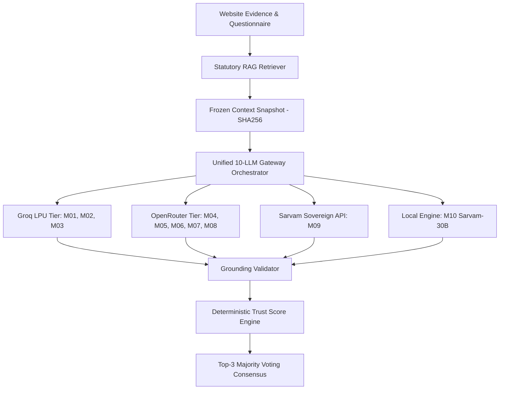

# TrustForge 10-LLM Unified Gateway Architecture
**Document Version:** 1.0.0-research  
**Research Paper:** *An Evidence-Grounded RAG Framework for Digital Personal Data Protection Compliance Assessment*  
**Date:** October 2026  
**Jurisdiction:** Republic of India (DPDP Act, 2023 & DPDP Rules, 2025)

---

## 1. Executive Architecture Overview

The TrustForge Unified LLM Gateway is designed to execute multi-model comparative legal evaluations across ten mandated foundation and open-weight models. It abstracts heterogeneous model APIs into a standardized, evidence-grounded evaluation contract while strictly respecting zero-cost constraints, provider-specific rate limits, and scientific auditability.



---

## 2. Model Registry Specification

Every candidate model is registered in `RESEARCH_MODELS` with immutable identification properties:

| ID | Required Model Name | Candidate / Resolved Endpoint | Family | Active / Total Params | Provider Tier | Verification Status |
|---|---|---|---|---|---|---|
| **M01** | OpenAI GPT-OSS-120B | `openai/gpt-oss-120b` | GPT-OSS | 5.1B / 117B | Groq LPUs | **LIVE_VERIFIED** |
| **M02** | OpenAI GPT-OSS-20B | `openai/gpt-oss-20b` | GPT-OSS | 3.6B / 21B | Groq LPUs | **LIVE_VERIFIED** |
| **M03** | Alibaba Qwen 3.8 27B | `qwen/qwen3.8-27b` | Qwen | 27B / 27B | Groq LPUs | **LIVE_VERIFIED** |
| **M04** | Google Gemma 4 31B-IT | `google/gemma-4-31b-it` | Gemma | 30.7B / 30.7B | OpenRouter | REQUIRES_CREDENTIALS |
| **M05** | Google Gemma 4 26B-A4B | `google/gemma-4-26b-a4b` | Gemma | 4.0B / 25.2B | OpenRouter | REQUIRES_CREDENTIALS |
| **M06** | Meta Llama 3.3 70B Instruct | `meta-llama/llama-3.3-70b-instruct` | Llama | 70B / 70B | OpenRouter | REQUIRES_CREDENTIALS |
| **M07** | Mistral Small 3 24B Instruct | `mistralai/mistral-small-24b-instruct-2501` | Mistral | 24B / 24B | OpenRouter | REQUIRES_CREDENTIALS |
| **M08** | DeepSeek V4.1 Flash | `deepseek/deepseek-v4.1-flash` | DeepSeek | ~16B / ~60B | OpenRouter | REQUIRES_CREDENTIALS |
| **M09** | Sarvam-105B Reasoning | `sarvam-105b` | Sarvam | 10.3B / 106B | Sarvam API | REQUIRES_CREDENTIALS |
| **M10** | Sarvam-30B Efficient | `sarvam-30b` | Sarvam | 2.4B / 32B | Local Weights | UNAVAILABLE (Hosted Deprecated) |

---

## 3. Concurrency, Batching & Rate-Limit Management

### 3.1 Token-per-Minute (TPM) Optimization
On Groq's free on-demand tier, the organization rate limit is **8,000 TPM** for GPT-OSS models and **7,000 ITPM** for Qwen 3.8. Individual evaluation of 20 controls across 10 models would trigger 200 HTTP calls, instantly exhausting per-minute request limits and failing.

To resolve this scientifically without modifying the evaluation rubric:
1. **Canonical Control Batching (`evaluateAllModelsBatch`)**: All 20 controls are dispatched in a single structured prompt per candidate model.
2. **Context Salience Bounding**: Statutory passages retrieved by RAG are trimmed to the first 200 characters of enforceable text.
3. **Evidence Excerpt Bounding**: Observed website evidence values are capped at 100 characters per item (12 items max).
4. **Completion Budget**: `max_tokens` is bounded to `1800` tokens, ensuring total requested tokens (`prompt + max_tokens`) remain at ~3,300 tokens, safely below the 8,000 TPM limit.

### 3.2 Concurrency & Pacing
- Groq models are dispatched with sequential 600ms pacing between models to prevent concurrent burst limits.
- Resilient exponential backoff with `Retry-After` header parsing handles transient HTTP 429 conditions.
- Provider unavailability or missing credentials returns structured status entries (`REQUIRES_CREDENTIALS`, `UNAVAILABLE`) instead of crashing the assessment pipeline.

---

## 4. Unified Model Output Schema

Every candidate model output is normalized and strictly validated using runtime JSON schema parsers:

```json
{
  "model_id": "M01",
  "control_id": "TF-PRIV-001",
  "verdict": "SUPPORTED | PARTIALLY_SUPPORTED | NOT_SUPPORTED | INSUFFICIENT_EVIDENCE | NOT_APPLICABLE",
  "confidence": 0.85,
  "legal_citations": [
    {
      "source_document": "dpdp-act-2023",
      "section": "Section 5(1)",
      "verbatim_quote": "Every request for consent shall be accompanied or preceded by a notice..."
    }
  ],
  "evidence_ids": ["EVID_POLICY_01"],
  "reasoning_summary": "Notice is partially present but lacks explicit purpose itemisation.",
  "identified_gaps": ["Notice does not provide separate opt-ins per processing purpose."],
  "remediation_steps": ["Itemise notice into distinct consent categories with multi-lingual support."]
}
```

---

## 5. Security & Zero-Cost Guarantees
1. **Never Expose Secret Keys**: API credentials (`GROQ_API_KEY`, `OPENROUTER_API_KEY`, `SARVAM_API_KEY`) are read strictly server-side from `process.env`. They are never passed to the client or embedded in Vite environment variables.
2. **No Fallback Disguise**: A deterministic fallback is never labelled as an LLM verdict. If a model cannot run, it is transparently reported as `REQUIRES_CREDENTIALS` or `UNAVAILABLE`.
3. **No Paid Incurrence**: No billable APIs are invoked without explicit faculty authorization.
